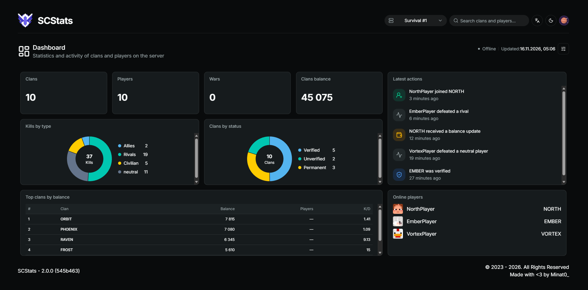
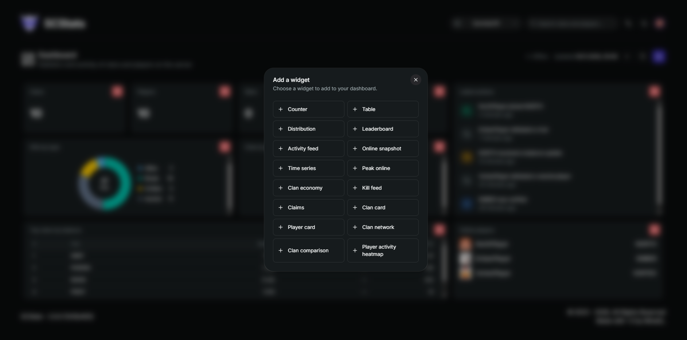
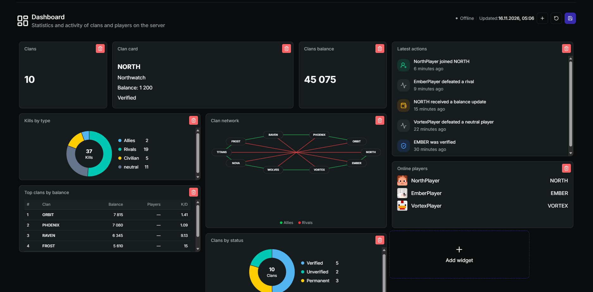
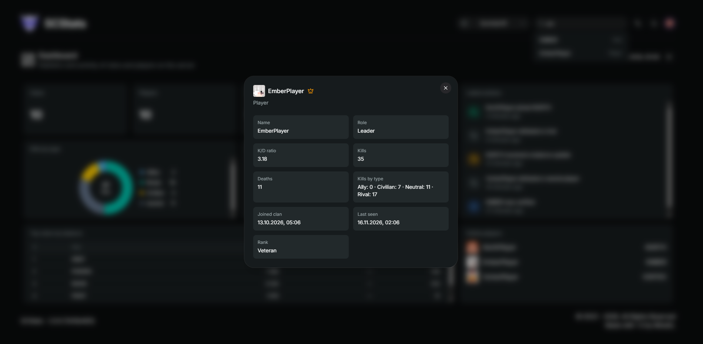
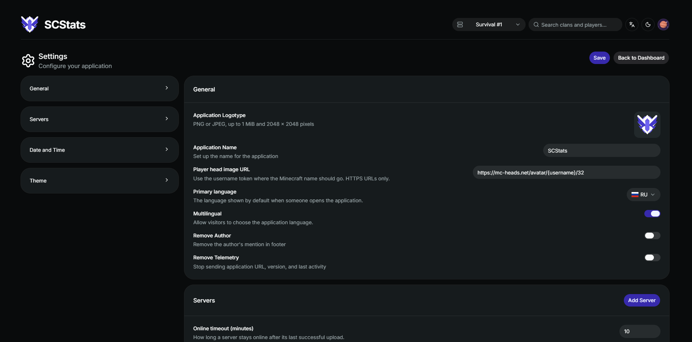
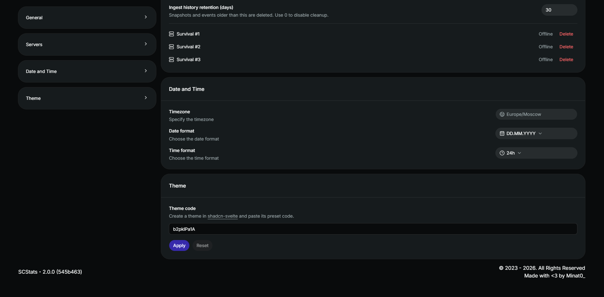

# SimpleClansStats

A web dashboard for viewing and exploring [SimpleClans](https://github.com/RoinujNosde/SimpleClans) data across one or more Minecraft servers written in Golang and SvelteKit.

Use the dashboard to monitor clan rosters, wars, balances, kills, online players, and recent activity. Search for a clan or player to view detailed information, or customize your dashboard widgets to focus on what matters most to your server. Manage multiple servers from a single installation.

The interface is available in English and Russian (contributions for additional translations are welcome!).

[](https://github.com/Tomut0/SimpleClansStats/actions/workflows/docker-publish.yml) [](LICENSE) [](https://github.com/Tomut0/SimpleClansStats/tags)

## Screenshots

| Dashboard | Add widget | Edit dashboard |
| --- | --- | --- |
|  |  |  |

| Player details | Settings | Settings |
| --- | --- | --- |
|  |  |  |

## Features

- Customizable Dashboard: Administrators can add, remove and reposition widgets to create their preferred dashboard layout.
- Real-time Updates: Server data and activity are updated in real time, keeping your dashboard up to date.
- Clan & Player Search: Find clans and players and explore their detailed statistics and information.
- Multilingual Support: Let users choose their preferred language or enforce a single application-wide language.
- Multi-Server Support: Connect and monitor multiple Minecraft servers from a single installation.
- Theme Customization: Choose from different themes powered by shadcn-svelte.
- Custom Branding: Personalize your installation with a custom application name and logo.
- Light & Dark Mode: Switch between light and dark appearances.
- API & Web Modes: Run the application with its built-in web interface or in API-only mode to build your own frontend.

## 📦 How to Install

### Standalone
For the very basic installation:
1. Download the binary file from [latest release](https://github.com/Tomut0/SimpleClansStats/releases/latest).
```bash
curl -fL "https://github.com/Tomut0/SimpleClansStats/releases/latest/download/simpleclansstats-linux-$( [[ "$(uname -m)" == "x86_64" ]] && echo "amd64" || echo "arm64" )" -o scstats
```
2. Make it executable and create a persistent folder:
```bash
chmod +x scstats
mkdir -p data
```
3. Copy [.env.example](https://github.com/Tomut0/SimpleClansStats/blob/master/.env.example) and rename it to `.env`, open the file and set variables.
4. Run! :)
```
./scstats --mode=web
```

Now visit `http://localhost:4000/` to see your web dashboard.

### Docker
```bash
docker run -d --name simpleclansstats `
  -p 4000:4000 `
  -v simpleclansstats-data:/data `
  -e BOOTSTRAP_ADMIN_EMAIL=admin@example.com `
  -e BOOTSTRAP_ADMIN_USERNAME=admin `
  -e BOOTSTRAP_ADMIN_PASSWORD='admin' `
  -e CORS_ALLOWED_ORIGINS=http://localhost:4000 `
  -e APP_URL=https://stats.example.com `
  -e APP_VERSION=2.0.0 `
  -e POSTHOG_API_KEY=phc_wboArzoxaHWqADcRiazJLa4otEs7KViZNgvzzsjMsdXX `
  -e POSTHOG_HOST=https://us.i.posthog.com `
  docker.io/minat0/scstats:latest
```

Now visit `http://localhost:4000/` to see your web dashboard.

### Nginx (Production)

Run SimpleClansStats in web mode on the Nginx host using [Standalone](#standalone) or [Docker](#docker).
Point your domain at that host and set both `APP_URL` and `CORS_ALLOWED_ORIGINS` to your HTTPS origin,
such as `https://stats.example.com`. With Docker, publish the app on loopback using
`-p 127.0.0.1:4000:4000`. With the standalone binary, block external access to port `4000` in the host firewall.

On Debian 13, install Nginx and its [Brotli filter](https://packages.debian.org/trixie/libnginx-mod-http-brotli-filter).

```bash
sudo apt update
sudo apt install nginx libnginx-mod-http-brotli-filter
```

Save this as `/etc/nginx/conf.d/simpleclansstats.conf`, which Nginx includes inside its `http` block.
Use your domain and the paths to its TLS certificate and private key.
[Nginx HTTPS setup](https://nginx.org/en/docs/http/configuring_https_servers.html)

```nginx
map $request_method $scstats_login_key {
    default "";
    POST    $binary_remote_addr;
}

limit_req_zone $scstats_login_key zone=scstats_login:10m rate=10r/m;

server {
    listen 80;
    listen [::]:80;
    server_name stats.example.com;

    return 308 https://$server_name$request_uri;
}

server {
    listen 443 ssl;
    listen [::]:443 ssl;
    server_name stats.example.com;

    ssl_certificate     /etc/letsencrypt/live/stats.example.com/fullchain.pem;
    ssl_certificate_key /etc/letsencrypt/live/stats.example.com/privkey.pem;
    ssl_protocols TLSv1.2 TLSv1.3;

    # Allow the collector's 8 MiB snapshots.
    client_max_body_size 8m;
    proxy_http_version 1.1;
    proxy_set_header Host $host;
    proxy_set_header X-Forwarded-For $remote_addr;
    proxy_set_header X-Forwarded-Proto $scheme;

    location = /api/v1/auth/login {
        limit_req zone=scstats_login burst=5 nodelay;
        limit_req_status 429;
        proxy_pass http://127.0.0.1:4000;
    }

    location /_app/immutable/ {
        brotli on;
        brotli_types application/javascript text/javascript text/css image/svg+xml;
        gzip_vary on;
        proxy_pass http://127.0.0.1:4000;
    }

    location = /api/v1/settings/theme {
        # Theme builds can take up to five minutes.
        proxy_read_timeout 320s;
        proxy_pass http://127.0.0.1:4000;
    }

    location / {
        proxy_pass http://127.0.0.1:4000;
    }
}
```

The `/login` form submits to `POST /api/v1/auth/login`. Nginx limits submissions to 10 per minute
per client IP with a burst of 5 and returns `429` when the limit is exceeded.
SimpleClansStats sees Nginx as one client, so proxied traffic shares the app's built-in 300 requests per minute limit.
If a CDN or load balancer sits in front of Nginx, configure Nginx to restore client IPs using the proxy's trusted addresses.
[Nginx real IP module](https://nginx.org/en/docs/http/ngx_http_realip_module.html)

Nginx compresses versioned frontend assets with Brotli and passes through the app's `Cache-Control` headers.

Apply the configuration and open your HTTPS URL.

```bash
sudo nginx -t && sudo systemctl reload nginx
```

## Support

If you have faced any issues, I'll answer on any questions in official
SimpleClans [discord](https://discord.gg/CkNwgdE).

## ✨ Sponsored By


### mikasa.host

It is my game hosting, the perfect solution for launching your own Minecraft server. \
For just $1 in a month, you can create a powerful server featuring top-tier components like Ryzen 9 5950X
processors, DDR4 RAM, and NVMe disks. Mikasa.host offers convenient and speedy registration via Discord and supports hosting servers for a variety of games, not just Minecraft.

<br clear="left">

## 😎 Thank you especially 

<a href="https://github.com/RoinujNosde"></a>
<a href="https://github.com/ToxicDuke"></a>
<a href="https://github.com/mehmet-27"></a>

## License

Licensed under the [Apache License 2.0](LICENSE).
